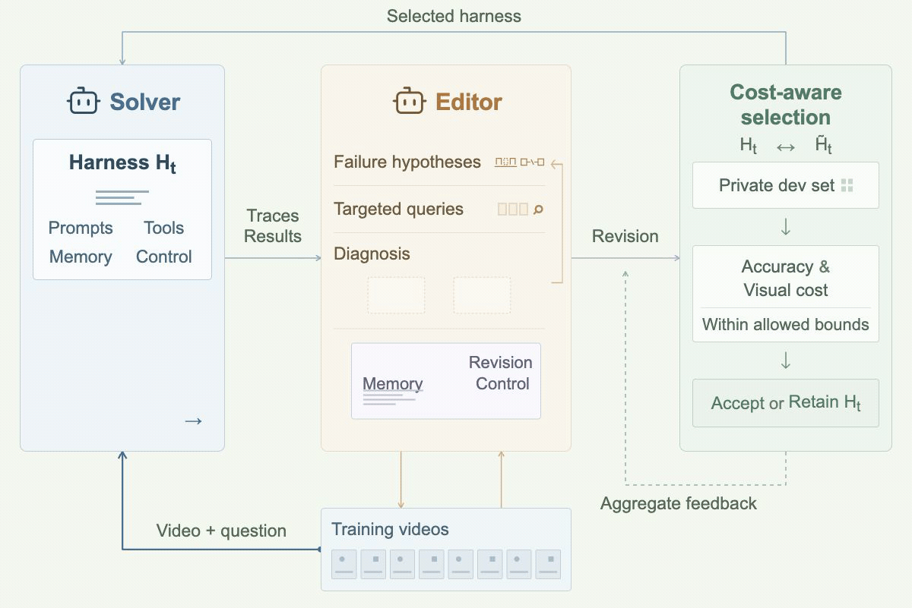

<div align="center">

# Video-RSI: Recursive Self-Improvement of Video Understanding Agents via Harness Evolution

Bingjun Luo · Jialin Guo · Siqi Li

[](https://bingjunluo.github.io/Video-RSI/)
[](https://huggingface.co/papers/2609.37950)
[](https://arxiv.org/abs/2609.37950)
[](https://paperswithcode.co/api/v1/papers/2609.37950/leaderboard-badge-link?eval=36016)
[](LICENSE)

[Run the Final Harness](#quick-start) · [Overview](#overview) · [Evaluation](#evaluation) · [Method to Code](#method-to-code) · [Results](#results) · [Harness Evolution](#harness-evolution) · [Citation](#citation)

</div>

## Overview

Video-RSI improves video understanding agents by evolving their executable
harnesses while keeping model weights frozen. The Editor investigates training
failures by revisiting videos, then turns the evidence into reusable code changes.

[](https://bingjunluo.github.io/Video-RSI/)

### Key Features

- **Active video investigation:** acquire new visual, transcript, and OCR evidence to diagnose training failures.
- **Executable harness evolution:** revise prompts, tools, memory, and execution logic.
- **Cost-aware selection:** retain revisions through paired accuracy and visual-frame evaluation on a private Gate set.

## Quick Start

### Run the final harness

The following steps run the released `artifacts/final_harness` on your videos. Both startup checking and inference explicitly select it with `--candidate artifacts/final_harness`.

### 1. Install

Use **Linux (x86_64 or aarch64) and Python 3.12**. Production execution requires an available Landlock interface and `libseccomp.so.2`; the runtime fails if isolation cannot be established.

Clone the repository, then install the pinned Python dependencies:

```bash
git clone https://github.com/bingjunluo/Video-RSI.git
cd Video-RSI
python3.12 -m venv .venv
source .venv/bin/activate
python -m pip install -r solver_full_workspace/requirements-lock.txt
```

### 2. Configure the models and OCR

Set `API_BASE` and `API_KEY` in the shell used to run the commands:

```bash
export API_BASE="https://your-provider.example/v1"
export API_KEY="YOUR_API_KEY"
```

Replace both placeholders with your own provider settings.
`API_BASE` is the HTTPS API root (e.g., `https://api.example.com/v1`), without `/chat/completions`.
The default models are **DeepSeek-V4-Pro** and **Qwen3.6-Plus**; settings are in
[`config.example.json`](config.example.json).
After generating the configuration below, edit `services.deepseek.request_model` and `services.qwen.request_model` in `config.local.json` to match the IDs supported by your provider.

Prepare local RapidOCR 3.9.2 PP-OCRv6 SMALL (CH) detection and recognition models,
then generate a configuration with their directory:

```bash
python configure.py \
  --output config.local.json \
  --ocr-model-root /path/to/ocr-models
```

`configure.py` writes a new configuration; it does not download OCR models or call model APIs. Choose a new output filename if the configuration already exists.

Commands with `--allow-provider-calls` use paid model APIs. Solver-only inference does not require the separate DeepSeek Harness / Node.js dependency.

### 3. Check startup

On the Linux machine where inference will run:

```bash
python -m solver_full_workspace.cli preflight \
  --config config.local.json \
  --candidate artifacts/final_harness
```

This checks candidate startup and isolation without model calls. It does not verify API access, video decoding, or OCR inference.

### 4. Prepare inputs and run inference

Provide JSONL inputs with `sample_id`, `question`, `options` (letter-to-text
mapping), `duration` (seconds), and an absolute `video_path`.
Each `sample_id` must be unique. Do not include answer labels in inference inputs.
Optional `asr_path` loads precomputed timestamped transcripts: JSON with a `segments` list containing `start`, `end`, and `text`. Transcription is not performed by this command.

<details>
<summary>Input format example</summary>

Save one JSON object per line in `items.jsonl`. Replace the example values
with your video's question, choices, actual duration, and absolute file path.
Keep answers in the separate labels file used for evaluation.

```json
{"sample_id":"video_001_q1","question":"What does the person do after entering the room?","options":{"A":"Sits on a chair","B":"Opens a window","C":"Picks up a book","D":"Leaves the room"},"duration":120.0,"video_path":"/path/to/videos/video_001.mp4"}
```

</details>

Run inference with the released final harness:

```bash
python run_batch.py \
  --config config.local.json \
  --candidate artifacts/final_harness \
  --items /path/to/items.jsonl \
  --output-dir outputs/final-harness \
  --allow-provider-calls
```

Predictions are saved to `outputs/final-harness/results.json`; use them in [Evaluation](#evaluation) below. The output directory must be new.

For an Initial-harness baseline, omit `--candidate` and use a different output directory. Omitting this flag does **not** select the final harness.

## Evaluation

Provide labels as separate JSONL records containing `sample_id` and `answer`:

```bash
python score.py \
  --items /path/to/items.jsonl \
  --predictions outputs/final-harness/results.json \
  --labels /path/to/labels.jsonl \
  --output outputs/final-harness/metrics.json
```

Reports accuracy and mean successful visual-call frame inputs per question.

## Method to Code

Paths beginning with `engine/` below are under [`solver_full_workspace/engine/`](solver_full_workspace/engine/).

| Component | Implementation | Entry point |
| :--- | :--- | :--- |
| Final Solver | [final harness](artifacts/final_harness/main.py) | `solve` |
| Batch inference | [run_batch.py](run_batch.py) | `run_batch` |
| Editor session | [engine/editor.py](solver_full_workspace/engine/editor.py) | `DeepSeekEditor` |
| Active investigation | [engine/investigation.py](solver_full_workspace/engine/investigation.py) | `Investigation.execute` |
| Evolution loop | [engine/evolve.py](solver_full_workspace/engine/evolve.py) | `Evolution.one_round` |
| Gate selection | [engine/evolve.py](solver_full_workspace/engine/evolve.py) | `gate_decision` |
| Scoring | [score.py](score.py) | `score` |
| Frame accounting | [engine/frame_cost.py](solver_full_workspace/engine/frame_cost.py) | `cost_usage` |

## Harness Evolution

After installing [DeepSeek Harness](dependencies/deepseek-harness/README.md),
create a separate evolution configuration:

```bash
python configure.py \
  --output config.evolution.local.json \
  --ocr-model-root /path/to/ocr-models \
  --harness-root /path/to/deepseek-harness \
  --node-binary /absolute/path/to/node
```

Update the model IDs in `config.evolution.local.json` for your provider, as in Quick Start step 2.

Sample LVBench training and Gate inputs:

```bash
python prepare_lvbench.py \
  --metadata /path/to/lvbench/video_info.meta.jsonl \
  --video-dir /path/to/lvbench/videos \
  --output-dir data/lvbench-split
```

Defaults are **216 training questions and 72 video-disjoint Gate questions**.
Videos are named `<video ID>.mp4`; optional `--asr-dir` attaches existing
`<video ID>.json` transcripts.

Initialize from the Initial harness and run evolution:

```bash
python -m solver_full_workspace.cli init \
  --root evolution/run-01 \
  --config config.evolution.local.json \
  --datasets data/lvbench-split/datasets.json

python -m solver_full_workspace.cli run \
  --root evolution/run-01 \
  --rounds 20 \
  --allow-provider-calls
```

Accepted harnesses are saved under `evolution/run-01/versions/`;
`current.json` identifies the retained version. Use any saved version with
`run_batch.py --candidate /path/to/version`. Run each command with `--help`
for additional options.

## Results

Comparison of the Initial harness and Video-RSI, as reported in the paper.

### Accuracy (%) ↑

| Benchmark | Split | Initial | Video-RSI |
| :--- | :--- | ---: | ---: |
| MLVU | Test | `62.4` | **`72.9`** |
| LongVideoBench | Long val | `67.7` | **`71.1`** |
| Video-MME | Long | `73.4` | **`80.0`** |
| EgoSchema | Public subset | `71.4` | **`78.2`** |

### Mean visual frames per question ↓

| Benchmark | Split | Initial | Video-RSI |
| :--- | :--- | ---: | ---: |
| MLVU | Test | `68.5` | **`61.1`** |
| LongVideoBench | Long val | `51.6` | **`41.1`** |
| Video-MME | Long | `38.6` | **`21.6`** |
| EgoSchema | Public subset | `66.0` | **`42.4`** |

Frames are mean frame inputs to successful visual-model calls per question. This metric excludes offline Editor investigation and is not total compute cost. The models remain frozen; the comparison uses DeepSeek-V4-Pro and Qwen3.6-Plus.

See the [paper, Tables 1–2](https://arxiv.org/html/2609.37950v1#S4) and [project page](https://bingjunluo.github.io/Video-RSI/#results) for comparisons and ablations. These are paper-reported results, not measurements from running this README.

## Citation

```bibtex
@article{luo2026videorsi,
  title={Video-RSI: Recursive Self-Improvement of Video Understanding Agents via Harness Evolution},
  author={Luo, Bingjun and Guo, Jialin and Li, Siqi},
  journal={arXiv preprint arXiv:2609.37950},
  year={2026}
}
```

## License

Video-RSI is released under the [MIT License](LICENSE).
Third-party components retain their respective licenses.

