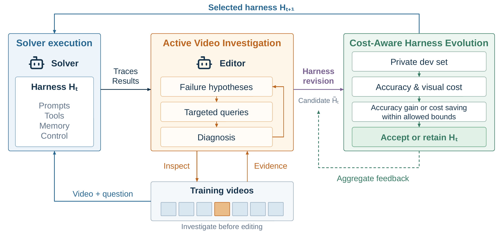

<div align="center">

# Video-RSI

### Recursive Self-Improvement of Video Understanding Agents via Harness Evolution

Bingjun Luo · Jialin Guo · Siqi Li

[](https://arxiv.org/abs/2609.37950)
[](LICENSE)

[Overview](#overview) · [Installation](#installation) · [Inference](#inference) · [Evaluation](#evaluation) · [Harness Evolution](#harness-evolution) · [Citation](#citation)

</div>

Official implementation of [Video-RSI](https://arxiv.org/abs/2609.37950), including
the Initial harness, the final harness, and the inference and evolution framework.

## Overview

Video-RSI improves video understanding agents by evolving their executable
harnesses while keeping model weights frozen. The Editor investigates training
failures by revisiting videos, then turns the evidence into reusable code changes.



- **Active video investigation:** acquire new visual, transcript, and OCR evidence to diagnose training failures.
- **Executable harness evolution:** revise prompts, tools, memory, and execution logic.
- **Cost-aware selection:** retain revisions through paired accuracy and visual-frame evaluation on a private Gate set.

## Installation

Use **Linux and Python 3.12**. Run the following commands from the repository root:

```bash
python3.12 -m venv .venv
source .venv/bin/activate
python -m pip install -r solver_full_workspace/requirements-lock.txt
```

Set `API_BASE` and `API_KEY` for your OpenAI-compatible service.
`API_BASE` is the HTTPS API root (e.g., `https://api.example.com/v1`), without `/chat/completions`.
The default models are **DeepSeek-V4-Pro** and **Qwen3.6-Plus**; settings are in
[`config.example.json`](config.example.json).
Set each `request_model` to the corresponding model ID supported by your provider.

Prepare local RapidOCR 3.9.2 PP-OCRv6 small detection and recognition models,
then generate a configuration with their directory:

```bash
python configure.py \
  --output config.local.json \
  --ocr-model-root /path/to/ocr-models
```

Commands with `--allow-provider-calls` use paid model APIs.

## Inference

Provide JSONL inputs with `sample_id`, `question`, `options` (letter-to-text
mapping), `duration` (seconds), and an absolute `video_path`.
Optional `asr_path` loads transcripts precomputed with faster-whisper large-v3:
JSON with a `segments` list containing `start`, `end`, and `text`.

<details>
<summary>Input format example</summary>

Save one JSON object per line in `items.jsonl`. Replace the example values
with your video's question, choices, actual duration, and absolute file path.
Keep answers in the separate labels file used for evaluation.

```json
{"sample_id":"video_001_q1","question":"What does the person do after entering the room?","options":{"A":"Sits on a chair","B":"Opens a window","C":"Picks up a book","D":"Leaves the room"},"duration":120.0,"video_path":"/path/to/videos/video_001.mp4"}
```

</details>

Run the final harness:

```bash
python run_batch.py \
  --config config.local.json \
  --candidate artifacts/final_harness \
  --items /path/to/items.jsonl \
  --output-dir outputs/final-harness \
  --allow-provider-calls
```

Omit `--candidate` to use the Initial harness. Use a new output directory;
predictions are saved to `results.json`.

## Evaluation

Provide labels as separate JSONL records containing `sample_id` and `answer`:

```bash
python score.py \
  --items /path/to/items.jsonl \
  --predictions outputs/final-harness/results.json \
  --labels /path/to/labels.jsonl \
  --output outputs/final-harness/metrics.json
```

Reports accuracy and mean successful visual-call frame inputs per question.

## Harness Evolution

After installing [DeepSeek Harness](dependencies/deepseek-harness/README.md),
create a separate evolution configuration:

```bash
python configure.py \
  --output config.evolution.local.json \
  --ocr-model-root /path/to/ocr-models \
  --harness-root /path/to/deepseek-harness \
  --node-binary /absolute/path/to/node
```

Sample LVBench training and Gate inputs:

```bash
python prepare_lvbench.py \
  --metadata /path/to/lvbench/video_info.meta.jsonl \
  --video-dir /path/to/lvbench/videos \
  --output-dir data/lvbench-split
```

Defaults are **216 training questions and 72 video-disjoint Gate questions**.
Videos are named `<video ID>.mp4`; optional `--asr-dir` attaches existing
`<video ID>.json` transcripts.

Initialize from the Initial harness and run evolution:

```bash
python -m solver_full_workspace.cli init \
  --root evolution/run-01 \
  --config config.evolution.local.json \
  --datasets data/lvbench-split/datasets.json

python -m solver_full_workspace.cli run \
  --root evolution/run-01 \
  --rounds 20 \
  --allow-provider-calls
```

Accepted harnesses are saved under `evolution/run-01/versions/`;
`current.json` identifies the retained version. Use any saved version with
`run_batch.py --candidate /path/to/version`. Run each command with `--help`
for additional options.

## Citation

```bibtex
@article{luo2026videorsi,
  title={Video-RSI: Recursive Self-Improvement of Video Understanding Agents via Harness Evolution},
  author={Luo, Bingjun and Guo, Jialin and Li, Siqi},
  journal={arXiv preprint arXiv:2609.37950},
  year={2026}
}
```

## License

Video-RSI is released under the [MIT License](LICENSE).
Third-party components retain their respective licenses.
